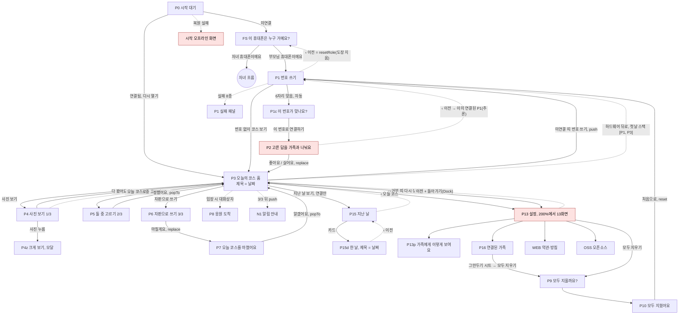
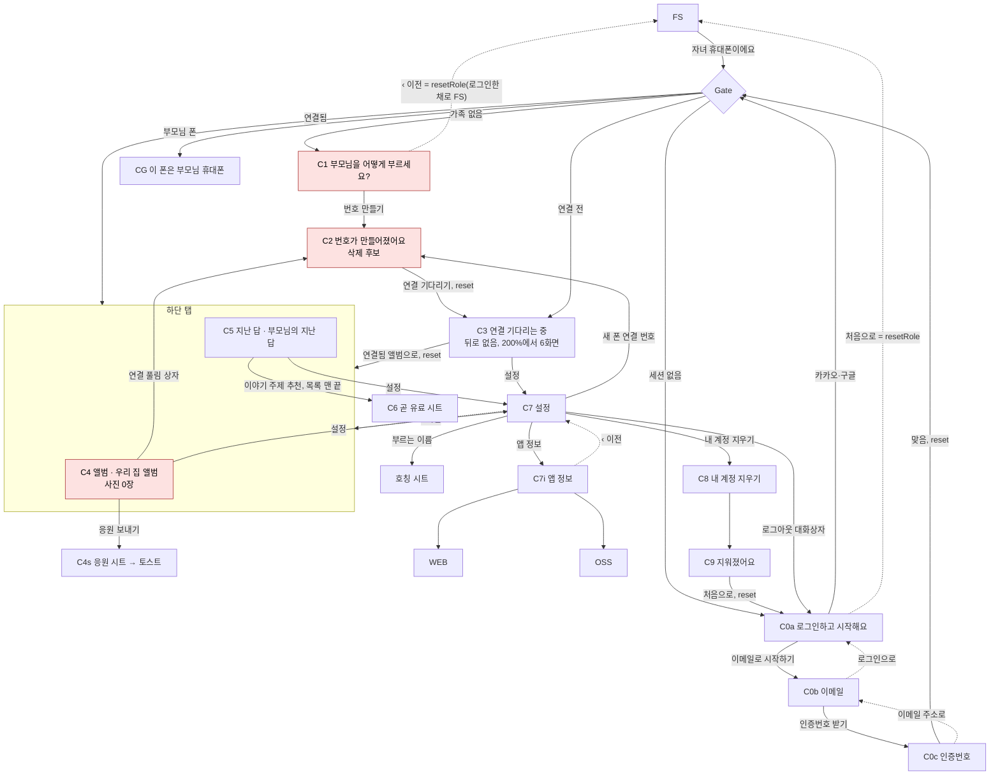

# 패널 4 · 네이버 관점 r1 — 정보 구조·탐색·큰 글씨 모드

- 작성: 패널 4(네이버 관점 재현 에이전트), 2026-11-20. 다른 패널 파일은 보지 않았다.
- 기준: 현재 앱 캡처·접근성 트리(`../inventory/`, main `6aa07a9`)와 앱 코드(main `67a6976`의 `app/src/app/*Stack.tsx`, `features/**`, `copy.ko.json`). 캡처 뒤 바뀐 코드는 코드 기준으로 적고 그렇다고 표시했다.
- 근거 1순위: `../references/04-naver.md`(N1~N8, N-Q1~8), `05-senior-patterns.md`(S1~S9, S-Q1~9). 네이버는 앱 디자인 원칙 원문을 공개하지 않았다(04 문서). 그래서 IA 판단에는 그린닷 개편(N5)·널리(N1)와 NN/g·W3C(S1·S2)를 함께 쓴다.
- 실측 표기: 접근성 트리 좌표는 `@(x, y)`(자르기 전 기준, 위 24 포함), 높이가 음수인 요소는 Dock·흐림 아래로 가려진 것이다. 200% = 시스템 글자 2.0, 360×640dp.
- 어르신 검증은 0회다. '익숙함' 판정은 모두 추정이다.

---

## 1. 한 줄 판정

**탭 깊이는 얕다. 가장 깊은 곳도 홈에서 두 번이다. 문제는 세 가지다. 같은 것을 부르는 이름이 여럿이고, 뒤로 가기 표기가 네 벌이며, 200%에서는 세로 길이와 스크롤 위치 때문에 길을 잃는다.**

### 가장 큰 문제 3개
1. **이름 체계가 없다.** 같은 대상을 화면마다 다르게 부른다. 예: 오늘의 코스 / 오늘 코스 / (P3 제목 없음), 지난 날 / 지난 답 / 최근 답, 자판으로 쓰기 / 한 단어 쓰기, 앨범 / 우리 집 앨범. 게다가 자녀 '앨범' 탭에는 사진이 한 장도 없다(DECISIONS 332줄도 "빌드 1에 '앨범'이 없으므로"라고 적었다). 뒤로 가기 링크 '오늘 코스로'가 가리키는 화면에는 '오늘 코스'라는 제목이 없다. TalkBack은 그 화면에 들어가면 날짜만 읽는다.
2. **뒤로 가기가 네 벌이다.** 목적지가 적히지 않은 '‹ 이전'이 15개 화면에 있다. 코스 세 단계 중 P6만 옛 '‹ 오늘 코스'를 쓴다. 여기에 '‹ 오늘 코스', 알약 모양 BackLink('오늘 코스로'·'처음으로'·'로그인으로'), 아래 Dock의 '돌아가기'가 섞여 있다. 같은 '처음으로'도 목적지가 셋(FS·P1·C0a)이다. 첫날 흐름에서 P3의 하드웨어 뒤로는 이미 연결된 번호 화면(P1)으로 간다(코드 추론). 그 화면에서 한 번 더 누르면 역할 초기화(`resetRole`)가 실행되고 기기 도장이 지워진다.
3. **큰 글씨(200%)에서 화면의 앞부분이 사라진다.** 한 단계를 마치고 P3에 돌아오면 날짜·설정·'지난 날 보기'가 위로 밀려 첫 화면에 없다. 위에 더 있다는 표시도 없다(R-19는 아래 띠만 둔다). 다른 사례도 있다. P6에서는 쓸 낱말이 Dock 밑에 가린다. 미연결 띠는 한 줄에 3~4자로 쪼개진다. 어르신 설정은 13화면 길이다. 자녀 C4는 고정 영역이 화면의 절반을 넘는다.

---

## 2. 화면 지도

### 2-1. 어르신 흐름

### 2-2. 자녀 흐름

### 2-3. 깊이 실측

| 할 일 | 경로 | 탭 수 | 세로 길이(200%) |
|---|---|---|---|
| 오늘 코스 한 단계 | P3 → P4 | 1 | — |
| 지난 날 한 날 다시 보기 | P3 → P15 → P15d | 2 | P3에서 '지난 날 보기'가 접힘 위에 있으면 위로 스크롤이 먼저다 |
| 가족에게 그만 보여 주기 | P3 → P13 | 1 + 펼침 | P13 첫 카드가 첫 화면에서 반쯤 잘린다 |
| 모두 지우기 | P3 → P13 → P9 | 2 | **P13 맨 끝(200% 13화면, `P13-linked-scrolled12-200`)** |
| 자녀: 지난 답 | 탭 | 1 | — |
| 자녀: 계정 지우기 | C4 → C7 → C8 | 2 | C7 4화면 |
| 자녀: 앱 정보 | C4 → C7 → C7i | 2 | 1화면 |

→ **탭 깊이는 문제가 아니다.** 손볼 곳은 스크롤 깊이, 이름, 뒤로 표기다.

---

## 3. 화면별 요소 감사

심각도 H = 길을 잃거나 핵심 정보가 안 보임, M = 헷갈리거나 규칙 위반, L = 다듬기. 비용 S = 문구·한 파일, M = 화면 하나 구조, L = 여러 화면·서버 계약.

### 3-0. 공통(모든 화면)

| 화면 | 요소 | 지금 | 왜 문제인가(근거) | 제안 | 심각도 | 비용 |
|---|---|---|---|---|---|---|
| 전체 | 뒤로 가기 표기 | 네 벌이다. ① 옛 `BackBar` '‹ 이전'(24 bold, 목적지 없음): P1·P1c·P2·P13·P13p·P15d·P16·P9·C1·C2·C7·C7i·CG·WEB·OSS(main 기준 16개 파일, `<BackBar` 19곳). ② 같은 `BackBar`의 '‹ 오늘 코스'(P15, **P6** — `KeyboardStep.tsx` 98·203줄). ③ ds `BackLink` 알약: '오늘 코스로'(P4·P5)·'처음으로'(C0a)·'로그인으로'·'이메일 주소로'. 코스 세 단계 중 P6만 모양과 문구가 다르다. ④ Dock '돌아가기'(P13, `settings.back`)·`review.back` '돌아가기' | RULES-V4 R-14는 'BackLink 하나, 목적지 문구, 보이는 글 = TalkBack 라벨'을 요구한다. '이전'은 어디로 가는지 말하지 않는다. 고령자는 막히면 자기 탓으로 돌린다(S1). 접근성 라벨도 '이전 화면으로 가기'라서 목적지가 없다 | `BackBar`를 없애고 ds `BackLink`로 통일한다. 문구는 목적지만 쓴다: '오늘 코스로'·'설정으로'·'지난 날로'·'앨범으로'·'처음 화면으로'. 진입처가 여러 곳인 화면(C7)은 직전 경로 이름으로 문구를 정한다 | H | M |
| 전체 | 화면 이름 사전 | 같은 대상, 여러 이름: `course.title` '오늘의 코스' / `course.to_home` '오늘 코스로' / P3 화면 제목 없음 · `history.title` '지난 날' / P3 링크 '지난 날 보기' / 자녀 '지난 답'·'최근 답' · P6 '자판으로 쓰기' / 기획·B2 '한 단어 쓰기' · `connect_wait.title` '연결을 기다리고 있어요' / 화면 글 '연결 기다리는 중' · 탭 '앨범' / 제목 '우리 집 앨범' | 링크 문구와 도착 화면 제목이 같아야 '맞게 왔다'고 확인할 수 있다(N1, 화면 전환 알림). 생성된 문서에서 흔한 흔들림이다(4절) | `docs/design/NAMES.md`(화면 이름 사전)를 만든다. 열은 id·화면 제목·링크 문구·뒤로 문구·TalkBack 첫 읽기다. copy 테스트로 링크 문구 = 도착 제목을 확인한다 | H | S |
| 전체 | '처음으로'의 목적지 | `login.back`·C0a → FS / `delete.parent.back` P10 → **P1**(`reset Connect`) / `delete.child.back` C9 → **C0a**(`reset Login`) | 같은 말이 세 곳으로 간다 | FS로 가는 것만 '처음 화면으로'로 쓴다. P10은 '번호 쓰기로', C9는 '로그인 화면으로'로 쓴다. 아니면 셋 다 FS로 보낸다(추천: 다 지운 뒤에는 역할부터 다시 고르는 것이 맞다) | M | S |
| 전체 | 상태 표시 틀 | 화면 틀이 두 벌이다. 옛 `ui/Screen`을 21개 파일이, ds `Screen`을 15개 파일이 쓴다. `StateView`는 자녀 3화면(C4·C5·C7)만 쓴다. 어르신 로딩은 맨 글자 '잠시만요'인데 크기가 20(P16)·22(P15)·24(P3)로 다르다. 오류도 화면마다 모양이 다르다. P3는 본문 안 알림+보조 버튼, P15는 제목+본문+Dock 버튼, P13p는 Banner, C7은 토스트다 | 상태가 같으면 모양도 같아야 '지금 무슨 일인지'를 배운다(S1: 오류는 눈에 띄는 자리에 고치는 법과 함께). 자녀 C4의 '받은 뒤 오류는 줄만 덧붙이고 내용 유지' 패턴이 가장 좋은데 어르신 쪽에는 없다 | `StateView` 하나로 통일한다(loading·empty·error·offline 4종, 어르신·자녀 audience). 로딩 문구는 무엇을 기다리는지 쓴다('오늘 사진을 가져오고 있어요'). 오프라인과 서버 오류를 모든 화면에서 나눈다 | H | L |
| 전체 | 오류·오프라인 검증 | SCREENS.md 6절: P2~P6·P9·P13p·P15·P16·C3~C5·C7·C8의 오프라인·서버 오류 상태를 **한 장도 찍지 못했다** | 큰 회사도 놓치는 부분이다(N7은 대비 사례). 지금은 상태 일관성을 판정할 근거가 없다 | fake API 실패 옵션을 개발자 메뉴에 노출하고 14화면 × 오류 2종 × 100/200을 재캡처한다 | M | M |
| 전체 | 위쪽 '더 있음' | R-19는 아래 띠만 둔다 | 200%에서 돌아왔을 때 스크롤된 화면은 위에 무엇이 있는지 모른다(P3 행 참조) | 돌아올 때 맨 위로 되돌리거나, 위로 넘친 경우에도 같은 24 띠(위 화살표)를 둔다 | M | S |
| 전체 | iOS 스와이프 뒤로 | `navigation/stackOptions.ts` TODO: 스와이프가 화면이 정한 뒤로(`useBackAction`)를 건너뛴다. 코스 단계에서 스와이프하면 직전 단계로 간다 | 두 플랫폼의 같은 동작이 다른 곳으로 간다 | 빌드 2 iOS 전에 `usePreventRemove`로 묶는다(이미 적힌 TODO, 우선순위 올림) | M | S |

### 3-1. 어르신(P)

| 화면 | 요소 | 지금 | 왜 문제인가(근거) | 제안 | 심각도 | 비용 |
|---|---|---|---|---|---|---|
| P0 | 대기 문구 | 2초 뒤 '잠시만요'만 보인다. 복원 실패 오프라인 화면은 캡처하지 못했다 | 무엇을 기다리는지 없다. 첫 실행과 다시 열기가 같은 말이다 | '오늘 사진을 가져오고 있어요'. 오프라인 화면은 S1 공통 틀로 맞춘다 | L | S |
| FS | 정보 우선순위 | 130%↑ 사진 숨김, 150%↑ 기능 줄 숨김. 역할 버튼 둘은 늘 보인다 | 큰 글씨에서 장식부터 접고 결정은 남긴다. 좋은 우선순위다 | 유지. 숨기는 순서를 NAMES.md·SCREENS에 규칙으로 적는다 | L | S |
| FS | 제목 위계 | '가화만사성'(38dp) → '하루 한 장, 우리 집 앨범' → '이 휴대폰은 누구 거예요?' | 결정 질문이 셋째 줄이다. 그래도 TalkBack 초점 그룹이 소개를 한 덩어리로 읽는다 | 유지. 단 '우리 집 앨범'은 자녀 C4 이름과 겹치므로 이름 사전에서 정한다 | L | S |
| P1 | 뒤로 | '‹ 이전' → `resetRole`(역할 초기화 + 기기 도장 지움) | 보이는 말은 '이전'인데 실제로는 '처음 화면으로'에 데이터 정리까지 한다 | 문구를 '처음 화면으로'로 바꾼다. 미연결 도장이 있으면 지우지 않는다(도장 지움은 '모두 지우기'만) | M | S |
| P1c | 두 출구 | '‹ 이전'과 '다른 번호 쓰기'가 같은 동작이다(`onOther`) | 같은 행동이 두 이름이다 | 위는 '번호 다시 쓰기로'로 쓰고, 아래 링크는 없앤다. 아니면 위만 남긴다 | L | S |
| P2 | 뒤로 | '‹ 이전'. 연결 직후 스택은 `reset [Connect, Consent]`라서 뒤로 가면 **이미 연결된 P1**이 나온다(코드 추론, 재현 필요) | 연결을 마쳤는데 번호 화면이 다시 나오면 연결이 안 됐다고 오해한다(S1 자기 탓) | P2는 뒤로를 없애거나 '나중에 정할게요'(=싫어요와 같은 결과)로 바꾼다. 스택을 `[Consent]` 하나로 reset | M | S |
| P3 | 하드웨어 뒤로 | 화면이 뒤로를 가로채지 않는다. 첫날은 스택이 `[Connect, CourseHome]`이라 뒤로 → P1 → 한 번 더 → `resetRole`. 다시 연 날은 P3가 첫 화면이라 앱이 닫힌다(코드 추론) | 같은 버튼이 날마다 다르게 동작한다. 막다른 길(P1)을 지나 데이터가 지워지는 길이 생긴다 | 연결·동의 뒤에는 `reset [CourseHome]`. P3에서 뒤로 = 앱 닫기(Android 관례)로 고정한다. Maestro 시나리오 추가 | H | S |
| P3 | 화면 제목 | 머리글(`accessibilityRole=header`, 진입 초점)이 날짜 '11월 19일 목요일'이다. '오늘의 코스'는 로딩 상태에서만 나온다 | 다른 화면의 뒤로 문구는 '오늘 코스로'인데 도착하면 그 이름이 없다. 널리가 지적한 화면 전환 알림(N1)에서 화면 이름을 읽어 주지 못한다 | 시각 제목은 날짜로 둬도 된다. 머리글 라벨은 '오늘 코스, 11월 19일 목요일'로 한다. 링크 문구·이름 사전과 맞춘다 | M | S |
| P3 | 200% 돌아왔을 때 스크롤 | 1/3·2/3·3/3-200 접근성 트리의 첫 요소가 `@(24,52) '둘 남았어요'`다. 날짜·설정·'지난 날 보기'가 위로 밀려 첫 화면에 없다(`P3-linked-1of3-200.png`). 첫 인사·거부 상태(첫 진입)에서는 보인다 | 화면의 입구(설정·지난 날)가 단계를 하나 마칠 때마다 사라진다. 위에 더 있다는 표시가 없다. 3/3-200은 첫 화면이 '여기까지예요' + 도장이고, '지난 날 보기'는 접힘 위에 있다. 하루를 마친 뒤 할 수 있는 유일한 다음 행동이 숨는다 | 돌아올 때(focus) 스크롤을 0으로 되돌리고, 초점은 Dock으로 보낸다. 3/3에서는 '지난 날 보기'를 Dock 보조로 올린다(B2 v2 P3D와 같다) | H | S |
| P3 | 미연결 띠 200% | 띠 글자 칸이 104dp다. '번호를/받으면/그때부/터 답이/저장돼/요' 6줄로 '요'가 홀로 남는다. 띠 높이 258dp, 코스 행 0개 보임, 스티치 구분선 두 줄이 붙어 있다(`P3-stg-unlinked-0of3-200.png`) | 200%에서 글과 링크가 한 줄을 나눠 쓴다. 화면의 주인(오늘 코스 행)이 첫 화면에 없다. R-10 취지(읽히게)에도 어긋난다 | 150%↑에서는 세로로 쌓는다(글 한 줄 → '번호 쓰기 ›' 아래 줄). 문구는 '번호를 받으면 답이 저장돼요'(14자)로 줄인다. 구분선은 하나만 | H | S |
| P3 | 100% 접힘 경계 | 1/3-100: '자판으로 쓰기, 다음 차례' 행이 높이 4dp만 보인다(`@(24,494) 312×4`). Dock 위 스티치에 걸린다 | R-15: 모든 배율에서 접힘 경계는 요소 경계여야 한다 | 셋째 행이 걸치면 간격으로 통째로 밀고 '더 있음' 띠를 둔다(foldPush를 P3에도 적용) | M | S |
| P3 | 진행 표시 세 겹 | '둘 남았어요'(인사) + 행 상태 '했어요/지금 할 차례/다음 차례' + Dock 문구 '둘 중 고르기' + (단계 화면) '2 / 3' | 같은 정보가 한 화면에 세 번 나온다. 200%에서 '둘 남았어요' 줄이 첫 화면 위 1/10을 쓴다 | 행 상태와 Dock은 유지한다. 인사 줄은 0/3·3/3에만 둔다(1/3·2/3은 행이 말해 준다). 다른 패널(토스·카피)과 r2에서 교차 확인 | L | S |
| P3 | 입구 수 | 설정, 지난 날 보기, 음악 켜기/끄기, (미연결 띠/거부 띠), Dock. 200%에서 '음악 켜기'가 날짜 줄에서 줄바꿈된다 | N-Q1 '오늘 코스 하나, 지난 날 하나'에는 맞는다. 다만 음악 토글이 날짜 줄에 끼면 줄 구조가 깨진다 | 음악 토글은 설정(소리)으로 옮긴다. P3 위 줄은 날짜 + 설정만 둔다 | M | S |
| P4·P5 | 뒤로·단계 머리 | (main) BackLink '오늘 코스로', '사진 보기 1 / 3', TalkBack '3단계 중 1단계' | 목적지 문구 + 위치 표시가 R-14를 지킨다. 이 앱에서 가장 좋은 탐색 패턴이다 | 유지하고 이 패턴을 기준으로 다른 화면을 맞춘다 | — | — |
| P6 | 뒤로 | 옛 `BackBar course` '‹ 오늘 코스'(자판 열림 상태 포함 두 곳) | 세 단계 중 P6만 모양·문구가 다르다. 같은 코스 안에서 뒤로가 바뀐다 | ds BackLink '오늘 코스로'로 바꾼다(R-15 자판 접힘 한 줄과 함께) | M | S |
| P4 | 200% 접힘 | '사진을 누르면 크게 보여요'가 높이 12dp만 보이고 흐림이 글자를 덮는다. 사진 아래 'AI가 만든 그림 · 실제 장소가 아니에요'는 Dock 밑(`-80dp`) | R-15·R-19(흐림은 글자 위에 겹치지 않는다). AI 표기는 BRIEF 제약인데, 사진 라벨에만 있고 눈에는 첫 화면에 없다 | 200%에서는 힌트 줄을 빼고(사진 버튼 라벨이 말해 준다), AI 표기는 사진 안 칩으로 첫 화면에 둔다 | M | S |
| P5 | 200% 접힘 | '읽어 주세요' 버튼이 높이 5dp만 보인다(`@(52,505) 257×5`) | R-15 | 걸치면 통째로 민다. 아니면 '읽어 주세요'를 질문 옆 아이콘+글자 버튼으로 올린다 | M | S |
| P6 | 200% 닫힘 | 쓸 낱말 칸 '나무'(`@(110,420) -36dp`)·'읽어 주세요'·'여기를 누르면 자판이 나와요'가 모두 Dock 밑이다. 첫 화면은 제목·안내·사진 위쪽만 보인다 | 단계의 핵심 정보(무엇을 쓸지)가 첫 화면에 없다. 토스 원칙 '큰 글씨에서 정보량을 줄이지 않는다'(S7)는 '안 보이게 밀지 않는다'까지 뜻한다 | 200%에서는 순서를 바꾼다: 낱말 칸 → 입력 칸 → 사진(작게). 사진 높이를 배율에 따라 줄인다 | H | M |
| P6 | 단계 이름 | 행·제목 '자판으로 쓰기', FS '사진 속 낱말을 자판으로 써요', 기획·B2 '한 단어 쓰기' | 이름이 '방법'(자판)인지 '할 일'(한 단어)인지 갈린다. 할 일 이름이 기억에 남는다 | 이름 사전에서 하나로 정한다. 추천은 '낱말 쓰기'. 할 일을 말하고, P4 '사진 보기'·P5 '둘 중 고르기'와 같은 '명사 + 동사' 꼴이다 | M | S |
| P3↔단계 | 허브 구조 | 각 단계가 끝나면 `popTo('CourseHome')`으로 P3에 돌아온다. P6만 P7로 `replace` | 장점: 늘 같은 홈에서 다음 행을 본다(위치 파악). 비용: 한 코스에 홈을 두 번 더 거친다 | 유지(어르신에게 위치 파악이 더 중요하다, 추정). 대신 돌아올 때 초점이 Dock에 가야 비용이 줄어든다(P3 행) | L | — |
| P7 | 화면 전체 버튼 | 무대 312×378dp 전체가 하나의 버튼이다('누르면 바로 넘어가요'). 200%에서 '이번 주 도장' 7칸이 Dock 밑으로 간다 | 어디를 눌러도 화면이 바뀐다. 손 떨림이 있으면 의도하지 않은 이동이 생긴다(S-Q5). 도장 줄은 P3 3/3과 같은 정보다 | 넘기기는 Dock '알겠어요' 하나로 한다(첫 1회 안내 없앰). 도장 줄은 한 곳(P3)만 둔다 | M | S |
| P8 | 대화상자 | P3 입장 때 덮개로 뜬다. 첫 인사가 있는 날은 뒤로 미룬다 | 덮개를 한 번에 하나로 정한 V1 규칙은 좋다 | 유지 | — | — |
| N1 | 경로 | 3/3 뒤 push로 뜨고 뒤로 가면 P3다. 다시 볼 곳은 P13 '알림' 스위치다. 문구가 같은 사실을 말한다('오늘 사진이 오면 알려') | 처음 묻는 곳과 바꾸는 곳의 이름이 맞는다 | 유지. 캡처 못 함 → 연결 staging에서 재캡처 | L | S |
| P13 | 길이·구조 | 섹션: 가족 / 알림과 소리 / 앱(약관·방침·오픈소스·AI 상자·병원 아님·사업자·문의·버전) / 모두 지우기. **100% 7화면, 200% 13화면**(`linked-scrolled12-200`). 자녀 C7은 '앱 정보'를 하위 화면(C7i)으로 뺐다 | 어르신 설정이 자녀 설정보다 길다. 거꾸로 됐다. 드물게 쓰는 법적 항목이 '모두 지우기' 앞을 가로막는다. 은행 쉬운 홈 평가처럼(S5) 자주 쓰는 것이 위, 드문 것은 '한 곳으로 모아 끝'에 두는 편이 낫다 | P13 = 가족(보여 주기·미리보기·연결된 가족) / 알림·소리(알림·음악·도장 소리) / '앱 정보 ›' 한 행 / '모두 지우기' 행. 법적·사업자·오픈소스·AI·버전은 P13i(어르신 앱 정보)로 옮겨 C7i와 같은 구조로 한다. 목표: 200% 4화면 이하 | H | M |
| P13 | 뒤로 두 개 | 위 '‹ 이전' + 아래 Dock '돌아가기'(보조 64) | 같은 동작에 이름이 둘이다. Dock은 주 행동 자리인데 뒤로가 차지한다. 200%에서 Dock이 본문을 줄인다 | Dock을 없애고 위 BackLink '오늘 코스로' 하나만 둔다 | M | S |
| P13 | 200% 첫 화면 | '가족에게 답 보여 주기' 카드가 흐림 밑에서 반쯤 잘린다(`P13-linked-200.png`). '그만 보여 주기' 버튼은 Dock 밑이다. 섹션 설명 2문장이 4줄을 쓴다 | R-15·R-19. 설명 문단이 행보다 먼저 공간을 쓴다 | 섹션 설명을 행 보조 한 줄로 줄인다('고른 답과 날짜가 보여요'). 카드는 통째로 민다 | M | S |
| P13 | 섹션 이름 '앱' | 머리 '앱' 아래 약관·문의·버전 | '앱'은 무엇을 담는지 말하지 않는다 | '앱 정보'(C7i와 같은 이름) | L | S |
| P13 | `[설정 필요]` 배지 | staging에 약관·방침·사업자 주소가 없다 | 출시 빌드 설정 문제다(IA 아님). 다만 배지가 그대로 나가면 빈 행이 3개 생긴다 | 릴리스 체크리스트에 env 확인을 넣는다 | L | S |
| P13p | 미리보기 | 제목 '가족에게 이렇게 보여요', Dock '알겠어요' | 어르신이 자녀 화면을 미리 보는 거울이다. 좋은 정보 구조다 | 유지. 자녀 C4에 사진이 들어가면(C4 행) 미리보기도 같이 바꾼다 | — | — |
| P15 | 진입·뒤로 | P3 글자 링크만 있다(미연결이면 숨김). 위는 '‹ 오늘 코스'(옛 문구) | '지난 날 보기' → 제목 '지난 날'은 맞는다. 뒤로 문구가 P4~P6의 '오늘 코스로'와 다르다 | '오늘 코스로'로 맞춘다. 3/3에서는 Dock 보조로 올린다(P3 행) | M | S |
| P15 | 목록 | 최근 30일, 최신이 위, 빈 날 없음, 카드 = 썸네일 + 날짜 + 고른 답 + 낱말. 카드 하나를 한 덩어리로 읽는다 | 빈 날을 보이지 않아 연속 기록이 되지 않는다(좋음). 30행이 되면 200%에서 아주 길다. 날짜 말고는 묶음이 없다 | 달이 바뀌는 곳에만 '11월' 같은 머리를 둔다(개수·연속 표시 없이). 맨 끝에 '맨 위로' 링크를 둔다 | L | S |
| P15 | 빈 상태 | '사진을 보면 여기에 모여요' | 다음 행동을 알려 주는 빈 상태다. 좋다 | 유지 | — | — |
| P15d | 한 날 | 제목 = 날짜, 뒤로 '‹ 이전', 전날·다음 날 이동 없음 | 목록 ↔ 상세를 왕복해야 한다. 뒤로 문구가 목록 이름을 말하지 않는다 | 뒤로 '지난 날로'. 전날·다음 날 이동은 넣지 않는다(연속 보기 압박, 6절) | L | S |
| P16 | 행 이름 | 가족 1명 행 '가족 휴대폰 · 11월 19일에 연결했어요' | 자녀가 둘이면 '가족 휴대폰' 두 행을 구별할 수 없다(N-Q2) | 행 이름에 연결한 날짜를 굵게 두거나, 자녀가 정한 이름이 아닌 '첫째로 연결한 가족' 같은 순서로 구별한다(어르신은 자녀 쪽 호칭을 모른다) | M | M |
| P16 | 지우기 입구 둘 | P13 '모두 지우기' 행 + P16 '그만두기' 시트의 '모두 지우기' | 같은 결과에 입구가 둘이고 이름이 다르다('그만두기') | P16 시트는 '보여 주기 그만'만 두고, 지우기는 P13 한 곳으로 모은다 | M | S |
| P9 | 출구 셋 | '‹ 이전' + '그만둘래요'(주) + '모두 지우기'(보조) | 취소가 두 번 있다. 위험 행동은 보조 자리라 맞다 | 위 BackLink '설정으로', '그만둘래요'는 유지 | L | S |
| P10 | 끝 | '처음으로' → P1(번호 쓰기) | '처음으로'가 FS가 아니다(공통 행) | FS로 보내고 문구는 '처음 화면으로' | M | S |

### 3-2. 자녀(C)

| 화면 | 요소 | 지금 | 왜 문제인가(근거) | 제안 | 심각도 | 비용 |
|---|---|---|---|---|---|---|
| C0a | 출구 | 위 BackLink '처음으로'(알약 132×56) + 아래 '부모님이시면 처음으로'. 200%에서 이메일 링크는 본문 끝으로 간다 | 잘못 들어온 어르신을 위한 출구가 둘이다. 목적은 분명하다. 알약 모양이 '‹ 이전'과 달라 같은 앱의 뒤로로 안 보인다(공통 행) | 유지. 뒤로 통일과 함께 '처음 화면으로' | L | S |
| C0b·C0c | 뒤로 | '로그인으로', '이메일 주소로' | 목적지 문구가 정확하다. 앱 전체의 기준으로 삼을 만하다 | 유지 | — | — |
| CG | 막힘 | '이 폰은 부모님 휴대폰으로 쓰고 있어요' + '‹ 이전' = resetRole | 캡처하지 못했다. 막다른 화면에 출구가 하나 있는 것은 맞다 | '처음 화면으로' 문구만 | L | S |
| C1 | 뒤로 | '‹ 이전' → `resetRole`. **로그인한 자녀가 역할 고르기(FS)로 간다** | '이전'이면 로그인 화면을 기대하는데 FS로 간다. 다시 자녀를 고르면 Gate → C1로 돌아온다. 원을 도는 길이다 | 뒤로를 없앤다(가입 첫 단계, C3처럼 R-14 예외로 등록). 아니면 '로그아웃하고 처음으로'로 무엇이 일어나는지 쓴다 | M | S |
| C2 | 존재 | C1 → C2 '번호가 만들어졌어요'(번호·보내기·연결 기다리기) → C3 '연결 기다리는 중'(같은 번호·복사·보내기) | 같은 번호를 두 화면이 연달아 보여 준다. SCREENS가 이미 '삭제 후보'로 적었다 | C1 → C3로 바로 간다. C2의 '7일 동안' 정보는 C3 번호 카드에 이미 있다. C7 '새 폰 연결 번호'도 C3 같은 틀의 시트로 한다 | M | M |
| C3 | 제목 위계 | 작은 라벨 '연결 기다리는 중'(30dp) 아래 큰 글 '엄마 폰에서 번호를 쓰면 이어져요'. copy에는 '연결을 기다리고 있어요'도 있다 | 화면 이름이 두 개다. 시각 제목은 큰 글이 맞다 | 큰 글을 머리글로, 작은 라벨은 없애거나 상태 칩으로. 이름 사전에 '연결 기다리기' 하나 | L | S |
| C3 | 200% 길이·접힘 | 200% 6화면. 첫 화면 끝에서 '이렇게 하시면 돼요'가 Dock 밑으로 걸친다(`-95dp`) | R-15. 단계 안내(설치 → 열기 → 번호)는 부모님께 전화로 읽어 줄 때 쓰는 핵심 정보다 | 걸침을 민다. 예시 사진 카드('매일 이런 사진과 질문이 가요')는 단계 안내 뒤로, 200%에서는 접기 | M | S |
| C3 | 뒤로 없음 | 가입의 끝이라 BackLink가 없다(R-14 예외). 설정은 있다 | 막다른 화면이지만 설정이라는 출구가 있어 괜찮다 | 유지 | — | — |
| C4 | 이름 vs 내용 | 탭 '앨범', 제목 '우리 집 앨범'. 카드 = '부모님의 최근 답 · 봄 · 오늘 · 봄 이야기를 해 볼까요?'. **사진 0장**. 사진·낱말이 자녀 화면 어디에도 없다(`ChildHome`·`ChildReport`에 photo 참조 없음) | 이름이 약속한 것(사진첩)과 내용(답 한 낱말)이 다르다. 자녀는 부모님이 '무엇을 보고' 봄을 골랐는지 모른다. 대화 거리('이야기 꺼내기')의 재료가 빠졌다. DECISIONS 332줄이 이 공백을 인정했다 | 1안(추천, 비용 L): 자녀 요약 계약에 그날 사진 썸네일·캡션·낱말을 넣는다. C4 카드 = 사진 + 고른 답 + 낱말. 2안(비용 S, 당장): 탭 이름을 '오늘', 제목을 '{호칭}의 오늘'로 바꾸고 '앨범'은 사진이 들어갈 때 쓴다 | H | L |
| C4 | 200% 고정 영역 | 위 바 ≈104dp + Dock(응원 보내기 72 + 여백) ≈120dp + 탭 바 88dp ≈ **312/616dp(51%)**. 카드의 이야기 문장이 흐림 밑에서 반쯤 잘린다(`C4-answer-today-200.png`) | R-12 Dock ≤ 40%(탭 바를 빼고 계산해도 경계다). R-15·R-19. 고정 틀이 내용보다 크다 | 200%에서 응원 버튼을 Dock에서 카드 바로 아래 본문으로 옮긴다(R-12 단서와 같은 방식). 위 바 '우리 집 앨범' 제목은 1.5 상한으로 한 줄을 유지한다 | H | M |
| C4 | 받은 뒤 오류 | 받은 내용이 있으면 화면을 두고 오류 줄만 덧붙인다(`accessibilityLiveRegion`) | 오류가 나도 정보를 지운다는 흔한 실수를 피했다 | 유지. 어르신 P3·P15에도 같은 규칙 | — | — |
| C4·C5 | 탭 둘의 역할 | C4 = 최근 답 1개 + 응원, C5 = 30일 목록(오늘 포함, 같은 답이 또 나온다) | 탭 하나가 정보 한 개를 위해 쓰인다. 오늘 답이 두 탭에 중복된다 | 유지하되 역할을 나눈다. C4 = '오늘'(사진·답·이야기·응원), C5 = '지난 답'(어제부터). 아니면 한 화면(오늘 카드 + 아래 지난 목록)으로 합치고 탭을 없앤다. r2에서 PM·카카오와 표결 | M | M |
| C4s | 응원 시트·토스트 | 시트 → 바로 보냄 → 토스트 + 취소 4~6초(탭 바 위) | 200%에서 취소 4~6초가 짧을 수 있다(자녀 기준이라 L) | 200%에서는 토스트 시간을 늘린다(8초) | L | S |
| C5 | 목록 행 | '오늘 · 봄과 가을 중 · 봄'. 행은 누를 수 없다. 사진·낱말 없음 | 어르신 P15는 같은 하루를 사진 + 답 + 낱말로 보고 한 날 화면까지 있다. 자녀는 답 한 단어만 본다. 같은 데이터인데 두 역할의 정보 구조가 다르다(N-Q2: 늘어나면 날짜로만 찾는다) | C4 1안과 함께: 행 = 썸네일 + 날짜 + 고른 답, 누르면 그날 보기(P15d와 같은 틀, 자녀 audience) | M | L |
| C5 | 유료 행 위치 | '이야기 주제 추천 · 곧 유료'가 목록 **맨 끝**이다 | 30일이 쌓이면 30행 뒤에 있다. 관심 신호(AC-01)를 재는 행인데 찾기 어려워 신호가 줄어든다 | 부제 줄 바로 아래(목록 위)로 옮긴다 | M | S |
| C5 | 제목 | 탭 '지난 답', 제목 '부모님의 지난 답'(200% 2줄) | 짧은 탭 + 구체 제목은 좋은 패턴이다 | 유지 | — | — |
| C6 | 시트 | 예정 가격 3종 + 관심 남김 | 시트라 깊이를 늘리지 않는다 | 유지 | — | — |
| C7 | 섹션 분류 | 부모님(부르는 이름·새 폰 연결 번호) / **계정**(가족 연결 알림 스위치, 로그인 방식, 로그아웃) / 내 계정 지우기 / 앱 정보 › | 알림 스위치가 '계정' 아래에 있다. 어르신 P13은 '알림과 소리' 섹션이라 두 역할의 분류가 다르다 | '알림' 섹션을 따로 둔다(어르신과 같은 이름). 계정 = 로그인·로그아웃·지우기 | M | S |
| C7 | 뒤로 | '‹ 이전'. 진입처가 C3·C4·C5 셋이다 | 목적지가 바뀌는 화면이라 '이전'으로 둔 것으로 보인다 | 직전 경로로 문구를 정한다('앨범으로'·'지난 답으로'·'연결 화면으로'). BackLink 공통 기능으로 만든다 | M | S |
| C7i | 앱 정보 | 버전·방침·문의·AI 상자를 하위 화면으로 뺐다 | 어르신 P13보다 좋은 구조다 | P13i의 본보기로 쓴다 | — | — |
| C8·C9 | 끝 | C8 범위별 경고 → C9 '처음으로' → C0a | '처음으로'의 뜻이 다르다(공통 행) | '로그인 화면으로' 또는 FS로 | M | S |
| N3 | 새 연결 배너 | 탭 화면 위 6초, '보기' → 앨범 탭 | 캡처하지 못했다. 배너가 토스트와 다른 자리라 겹치지 않는다 | 유지 | L | — |

---

## 4. 시중 앱과의 차이 (이 관점의 기준)

| 기준 | 그쪽(출처) | 우리 | 판정 |
|---|---|---|---|
| 홈에 한 가지만 | 네이버 그린닷: 검색창 중심 홈, 나머지는 아래 원 하나(N5) | P3 = 오늘 코스 3행 + Dock 하나. 입구는 설정·지난 날 둘 | **우리가 더 단순하다.** 다만 음악 토글이 날짜 줄에 끼어 '한 가지'를 흐린다 |
| 걷어낼 때 익숙함도 걷어내는가 | 그린닷은 '깔끔'과 '익숙함 상실' 평이 갈렸다(N5) | U-8로 P4·P5 하단 '오늘 코스로'를 지우고 위 BackLink만 남겼다 | 위험이 같다. 어르신은 아래 큰 버튼에 익숙할 수 있다(추정). V27 관찰에서 '돌아가기를 찾는 시간'을 잰다 |
| 큰 글씨 대응 방식 | 네이버 앱 안 큰 글씨 모드는 확인 못 함, 검색 결과의 '글자 크게 보기'만 소개된다(04-2). 토스는 OS 배율을 따르고 정보를 줄이지 않는다(S7) | OS 배율 200%까지 따른다. 모드 전환은 없다 | **방향은 토스와 같고 네이버보다 낫다.** 품질이 들쭉날쭉하다: P3 미연결 띠·P6 낱말·C4 고정 영역·P13 길이 |
| 쉬운 화면 진입 위치 | 은행 쉬운 홈: 맨 위 토글은 찾기 쉽고 맨 아래 숨김은 어렵다(S5) | '가족에게 답 보여 주기'가 P13 맨 위(좋음), '모두 지우기'가 맨 아래(맞음). 그 사이에 법적 항목 6행이 끼어 있다 | 위치 원칙은 맞고 중간이 길다 → P13i로 뺀다 |
| 목록 형태 | Assistive Access: 격자 또는 **글자 목록(행)** 중 고름, 핵심 활동만(S3) | 어르신 P3·P13·P15 모두 행 목록, 아이콘+글자 | 맞다. 행 높이 64~72도 기준보다 넉넉하다 |
| 준비는 가족이 | Assistive Access: 믿을 수 있는 지원자가 설정(S3) | 호칭·새 폰 번호는 자녀 C7에 있다. 어르신 P13에는 번호 쓰기(미연결만)만 있다 | 좋다(S-Q6 충족). 음악·도장 소리 같은 어르신 설정은 남긴다 |
| 화면 전환 알림 | 널리: 화면이 바뀔 때 소리 알림이 없는 문제를 다뤘다(N1) | Screen이 진입할 때 첫 머리글에 초점을 준다(R2). P7·P6 완료는 live region | 구조는 갖췄다. **P3 머리글이 날짜라 화면 이름을 못 알린다** |
| 사람 손글씨의 흔적 | 나눔손글씨: 실제 사람 손글씨 109종(N3), 손글씨 기록 캠페인(N8) | 어르신이 친 글자는 **저장하지 않는다**(`api/contract/history.ts` 주석). 자녀는 낱말도 받지 않는다 | N-Q5: 흔적이 없다. 차별점이 될 수 있는 정보가 정보 구조에서 빠졌다(5절 B2와 연결) |
| 상태 표시 일관성 | 네이버 공개 근거 없음(미확인). NN/g: 오류는 눈에 띄는 자리에 고치는 법과 함께(S1) | 자녀는 StateView로 일관된다. 어르신은 화면마다 모양이 다르다 | 자녀 쪽이 더 낫다 → 어르신으로 넓힌다 |
| 지난 기록 찾기 | 네이버는 검색·목록 중심 포털이다(04 '다른 점') | 30일 고정, 날짜 순, 검색·필터 없음 | **우리가 맞다.** 30일이면 날짜 순 하나로 충분하다. 검색을 넣지 않는다(6절) |

---

## 5. AI스러움 (정보 구조에서 보이는 '생성된 느낌')

| # | 구체 요소 | 왜 생성된 느낌인가 | 대안 |
|---|---|---|---|
| AI-IA-1 | P13에 법적·사업자·오픈소스·AI·병원 아님·문의·버전을 **한 목록에 빠짐없이** 쌓았다 | 요구사항 체크리스트를 그대로 펼친 모양이다. 실제 앱은 드문 것을 '앱 정보' 한 행 뒤에 둔다 | P13i로 뺀다(3-1) |
| AI-IA-2 | 섹션·화면마다 설명 문단이 붙는다(P13 가족 2문장, P2 3줄, P15·C5 부제, C3 예시 카드) | '모든 것을 설명하는' 생성 습관이다. 200%에서 설명이 행보다 먼저 첫 화면을 쓴다 | 행 보조 한 줄로 바꾼다. 설명은 처음 한 번(시트·첫 방문)만 |
| AI-IA-3 | 같은 대상, 여러 이름(1절·3-0) | 용어집 없이 화면마다 따로 쓴 문구다 | 이름 사전 + copy 테스트 |
| AI-IA-4 | 진행 표시 세 겹(인사 줄·행 상태·Dock·n/3) | 놓칠까 봐 다 넣은 모양이다 | 한 화면에 진행 표시는 하나(행 상태), 보조 하나(n/3, 단계 화면만) |
| AI-IA-5 | 미연결 200%에서 스티치 구분선 두 줄이 붙어 나온다 | 장식이 구조와 상관없이 반복된다 | 구분선은 섹션 사이 하나. 내용이 없으면 구분선도 없다 |
| AI-IA-6 | 오류 문구 '잠시 뒤에 다시 해 볼까요?'가 서버·바쁨·지난 답·자녀 홈에 똑같이 나온다 | 무엇이 안 됐는지 빠진 공용 문장이다 | 대상을 쓴다: '지난 답을 못 가져왔어요', '오늘 사진을 못 가져왔어요' |
| AI-IA-7 | 뒤로 '‹ 이전' + 아래 '돌아가기'(P13), '‹ 이전' + '다른 번호 쓰기'(P1c) | 출구를 '안전하게' 두 번 둔 모양이다 | 출구 하나, 목적지 이름 |
| AI-IA-8 | '앨범'이라는 이름 아래 사진 없는 카드 | 콘셉트 단어(앨범)를 내용 확인 없이 붙였다 | 이름을 내용에 맞추거나, 내용을 이름에 맞춘다(C4) |

---

## 6. B2 v2 '장날 팻말' 평가 (정보 구조 관점)

### 이득
1. **3/3 상태의 정보 구조가 분명해진다.** P3D는 홈 맨 위에 오늘 팻말을 두고, Dock에 '오늘 코스 다시 보기'(보조)와 '지난 날 보기'(링크)를 둔다. 지금 앱 200%에서 '지난 날 보기'가 접힘 위로 숨는 문제(3-1 P3)가 시안 단계에서 풀려 있다(`img/b2v2-market-P3D-200.png`).
2. **도장 7칸이 사라져 P3·P7 중복이 없어진다.** 지난 날은 세로 목록, 최근 것이 위, 빈 날 표시 없음이다. 30일 목록 원칙과 맞다.
3. **'파랑 = 누르는 것'이라 탐색 요소가 한눈에 갈린다.** BackLink '‹ 오늘 코스로'(알약, 파랑)·링크(밑줄+파랑)·주 버튼(파랑 면). 지금의 갈색은 글자·버튼·장식에 다 쓰여 누를 수 있는 것과 아닌 것이 덜 갈린다. 정확한 대비 판정은 다른 패널 몫이다.
4. 뒤로 문구가 목적지('오늘 코스로')로 통일돼 있다. R-14와 맞는다.

### 위험
1. **데이터 계약과 맞지 않는다(가장 큼).** 시그니처는 '쓰신 낱말이 팻말이 되어 자녀 C4로 간다'인데 지금은 이렇다.
   - 어르신이 친 글자는 저장하지 않는다(`history.ts`).
   - P6는 콘텐츠 낱말과 **일치**해야 마친다('낱말을 한 번 더 볼까요?' 대화상자). 그래서 '사투리·잘못 친 글자도 그대로'(directions-v2 2절)는 지금 P6 규칙과 맞지 않는다. 팻말 낱말은 실제로 콘텐츠 낱말(`photo.keyword`)이다.
   - 자녀 요약에는 낱말도 사진도 없다.
   → 채택하려면 자녀 요약 계약 확장(낱말·사진)이 먼저다. 문구 '쓰신 낱말 그대로'는 '오늘 쓰신 낱말'로 사실에 맞춘다. 서버·DECISIONS에 적을 결정이다.
2. **지난 날(H) 200%의 첫 화면에 목록 행이 0개다.** 안내 두 문장('누르면 그날 사진을 다시 봐요. 사진은 모두 AI가 만든 그림이에요')이 5줄로 첫 화면을 다 쓴다(`img/b2v2-market-H-200.png`). 목록 화면은 첫 행이 첫 화면에 보여야 한다.
3. **P3D 200%에서 팻말과 날짜가 첫 화면의 절반 넘게 쓴다.** 설정은 오른쪽 위에 혼자 있어 왼쪽 정렬 규칙과 어긋난다. 날짜 줄 '11월 20일 장날 아침'은 날짜와 콘텐츠 이름이 붙어 날짜를 읽기 어렵다.
4. 팻말에 못·끈이 있어 **누를 수 있는 것처럼 보일 수 있다**(R-06: 누르는 것에는 면·밑줄·아이콘). 팻말이 눌리지 않는다면 이 오해를 V27에서 확인한다.
5. '넘어갈게요'로 마친 날의 팻말은 규칙만 있고 그림이 없다. 지난 날 목록에서 팻말 있는 행과 없는 행이 섞이면 '없는 날'이 결국 눈에 띈다.

### 고칠 점
- H: 안내를 한 줄('누르면 그날을 다시 봐요')로 줄인다. AI 표기는 각 썸네일 라벨과 목록 끝 한 줄로 옮긴다. 200%에서 첫 행이 첫 화면에 보여야 한다.
- P3D: 설정을 날짜 줄 왼쪽 묶음으로, 날짜와 콘텐츠 이름은 두 줄로 나눈다. 팻말은 200%에서 1.5 상한 + 높이 상한을 둬 Dock 위에 지난 날 링크까지 첫 화면에 들어오게 한다.
- C4: 팻말과 함께 **그날 사진 썸네일**을 둬 '앨범' 이름과 내용을 맞춘다(3-2 C4 1안). B2 채택 여부와 상관없이 필요하다.
- 이름 사전에 '쓰신 낱말'·'지난 날'·'오늘 코스'를 먼저 등록하고 B2 문구를 거기서 가져온다.

---

## 7. 하지 말아야 할 것 (이 관점의 함정)

1. **포털처럼 만들지 않는다.** 어르신 화면에 하단 탭·검색·필터·달력을 넣지 않는다. 네이버의 강점(검색·목록)은 하루 한 코스 앱에는 비용이다(04 '다른 점').
2. **200% 대응을 '숨기기'로만 풀지 않는다.** FS의 장식 접기는 괜찮다. 핵심 정보(P6 낱말, AI 표기, 지난 날 입구)를 접힘 밑으로 밀어 두는 것도 숨기기다. 순서를 바꾸고 크기를 줄인다.
3. **목적지 없는 뒤로를 새로 만들지 않는다.** '이전'·'돌아가기'는 금지어로 둔다(lint 또는 copy 테스트).
4. **설정을 여러 단계로 쪼개지 않는다.** 하위 화면은 '앱 정보' 한 단계만 둔다. 가족·알림은 첫 화면에 남긴다. 깊이를 줄이려다 깊이를 늘리지 않는다.
5. **걷어낼 때 익숙함까지 걷어내지 않는다(N5).** P4·P5 하단 '오늘 코스로' 삭제 같은 결정은 V27 관찰 뒤 확정으로 표시한다.
6. **지난 날에 전날·다음 날 넘기기, 개수, 빈 날 표시를 넣지 않는다.** 탐색 편의가 연속 보기 압박이 된다(BRIEF 연속 보상 금지).
7. **어르신과 자녀가 같은 것을 다른 이름으로 부르게 두지 않는다.** 어르신은 '지난 날', 자녀는 '지난 답'처럼 갈리면 가족끼리 통화할 때 서로 다른 말을 쓴다.
8. **스택을 쌓은 채로 두지 않는다.** 연결·동의·삭제 같은 '돌아가면 안 되는 단계' 뒤에는 늘 reset한다. 하드웨어 뒤로로 지난 단계에 돌아가는 길을 남기지 않는다.

---

## 부록 A. N-Q 판정 요약

| # | 판정 | 근거 |
|---|---|---|
| N-Q1 | 대체로 예. 음악 토글이 줄 구조를 흐린다 | 3-1 P3 입구 수 |
| N-Q2 | 자녀는 날짜로만 찾는다. 사진·낱말이 없다. 30일이라 찾기는 되지만 '무엇을 보고 고른 답인지'를 모른다 | 3-2 C5 |
| N-Q3 | 진입 초점은 있다. P3 머리글이 날짜라 화면 이름을 못 알린다. P7은 live region이 있다 | 3-1 P3 화면 제목 |
| N-Q4 | P4 AI 표기 글줄이 200%에서 Dock 밑에 있다(사진 라벨에는 있다). P6 '쓸 낱말, 나무, 두 글자'는 읽는다 | 3-1 P4·P6 |
| N-Q5 | 흔적을 살리지 않는다(저장 안 함, 자녀 화면에 없음) | 4절, 6절 위험 1 |
| N-Q6 | 패널 2·5 몫. IA 관점에서는 부리꼴을 사진 캡션(P4·P15d)에 한정하면 위계가 갈린다(미확인, 비교 필요) | — |
| N-Q7 | P15 목록 200%는 캡처 못 함(fake 빈 배열). 시안 H-200은 첫 행이 첫 화면에 없다 | 6절 위험 2 |
| N-Q8 | U-8 하단 링크 삭제가 해당한다. 관찰 전 확정은 위험 | 7절 5 |

## 부록 B. 재캡처·확인 요청
- 첫날 흐름 P2 → P3에서 하드웨어 뒤로 두 번(코드 추론 확인): P1이 나오는지, `resetRole`이 실행되는지.
- P3 200%: 단계를 마치고 돌아왔을 때 스크롤 위치(캡처 1/3·2/3·3/3-200 재현).
- 어르신 P15 목록·P15d(연결된 staging 가족), 오류·오프라인 14화면(SCREENS 6절).
- 411×914 · 200%에서 P13·C4 고정 영역 비율.
